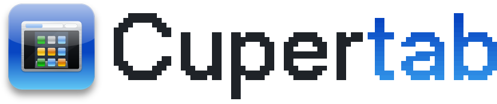

<h1 align="center">
  <picture>
    <source media="(prefers-color-scheme: dark)" srcset="docs/title-dark.png">
    <source media="(prefers-color-scheme: light)" srcset="docs/title-light.png">
    
  </picture>
</h1>

**iOS 4 in a browser tab. It boots Apple's own SpringBoard from an IPSW you bring.**

<p align="center">
  <a href="https://cupertab.dino.icu/">Try it</a> ·
  <a href="#booting-ios-4">Boot iOS 4</a> ·
  <a href="#running-an-app">Run an app</a> ·
  <a href="#how-it-works">How it works</a> ·
  <a href="#the-jit">The JIT</a> ·
  <a href="#building-it">Build it</a> ·
  <a href="#reporting-problems">Report a bug</a>
</p>

Cupertab (formerly touchHLE-web) is a port of [touchHLE](https://github.com/touchHLE/touchHLE) that runs in a web browser. It started as a fork of touchHLE. touchHLE is a high-level emulator for early iOS apps. It runs the app's own ARM code, and in place of iOS it uses its own versions of the system frameworks. Cupertab builds it to WebAssembly. It can also boot iOS 4 from an IPSW you supply. For that, Cupertab emulates the iOS kernel, so Apple's own SpringBoard and apps run in the tab unmodified.

[Open the page](https://cupertab.dino.icu/), pick your files, and it all runs in that tab. Nothing is uploaded. Cupertab ships no Apple firmware and no keys, so you bring your own `.ipsw` and the root filesystem key for it, or a decrypted `.ipa` of an app you own. [How it works](#how-it-works) explains the parts in the picture below.

<p align="center">
  
</p>

The name Cupertab is a play on Cupertino and the word "tab". This project is not affiliated with or endorsed by Apple Inc in any way. iPhone, iOS, iPod, iPod touch and iPad are trademarks of Apple Inc in the United States and other countries.

Only use touchHLE to emulate software you have obtained legally.

## Running an app

Open the page and wait until the buttons stop saying "Loading…". Click "Choose .ipa" and pick an app you own. The page reads the file into the tab and runs it there. Nothing is uploaded.

The app has to be decrypted. touchHLE refuses encrypted App Store binaries.

touchHLE runs apps for iPhone OS 2.x, iPhone OS 3.x and iOS 4.0.x. Upstream's README says most of those apps don't work yet, and the ones that do are mostly games. The [touchHLE app compatibility database](https://appdb.touchhle.org/) lists what works in the native build. The browser build has had much less testing.

Each page load runs one file. To run another, reload the page. Anything the app saves is lost when you reload.

## Booting iOS 4

Cupertab ships no Apple firmware and no decryption keys. To boot iOS 4 you need your own `.ipsw` and the root filesystem key for that firmware. The root filesystem image inside an IPSW is encrypted, and touchHLE can't read it without the key.

1. Type the key (72 hex digits) into the "Root filesystem key" field.
2. To put your own apps on the home screen, click "Add .ipa to home screen" and pick them.
3. Click "Boot iOS 4 .ipsw" and pick the IPSW.

If the key isn't 72 hex digits, the page won't start. If it's the wrong key for that firmware, the boot stops with an error. The native build takes the key as `--rootfs-key=KEY`.

The only firmware tested so far is iOS 4.2.1 for the iPhone 3G (iPhone1,2, build 8C148). It boots to the lock screen, you unlock it by dragging the slider with the mouse, and apps open from the home screen. Calculator, for example, opens from the Utilities folder.

The screen stays black while it boots, so watch the status line above it. The Home button under the screen, or the Home key on your keyboard, presses the iPhone's Home button. If SpringBoard turns the screen off, tap it or press Home. Only one app runs at a time, so opening an app closes the one before it.

The first boot unpacks the root filesystem image from the IPSW and saves it in the browser's site storage. It keeps one image, from the last IPSW. If you pick the same IPSW again, the page skips that step. The saved image is still encrypted, so every boot needs the key. Once the key opens the firmware, the page remembers it. The page also saves the decrypted dyld shared cache from that image, so later boots skip decrypting and inflating it (about 170 MB, a few seconds of work).

When a boot reaches the lock screen, the page also saves a snapshot of it. The next time you pick the same IPSW with the same key, the page starts from that snapshot, so the lock screen shows up in under a second instead of after a full boot. If the snapshot can't be used (it's damaged, from another build, or slow to read), the page deletes it, boots normally, and saves a new one. The same happens when iOS has changed its saved files since the snapshot was taken. The page doesn't use or save a snapshot when you add .ipa files to the home screen. To turn snapshots off, add `?snapshot=off` to the address.

Everything the page saves (the root filesystem image, the decrypted shared cache, iOS's own saved files and the snapshot) stays in your browser's site storage and is never uploaded. The "Clear saved data" link deletes all of it, and so does clearing the site's data.

## The JIT

By default the guest's ARM code runs in an interpreter. To try the experimental JIT, add `?jit=on` to the address: https://cupertab.dino.icu/?jit=on. It turns hot blocks of ARM and Thumb code into WebAssembly, and the rest still runs in the interpreter. If the browser won't compile a block, that code stays in the interpreter too.

## Browser requirements

The page needs WebAssembly, WebGL and a lot of memory. It asks for about 1.2 GB when it starts, and booting iOS 4 takes it past 2 GB. It has been tested in desktop Chromium. Reloading the same tab many times can run it out of memory, so open a new tab instead.

## How it works

Everything runs in one browser tab. The page reads your files into the tab, and touchHLE runs them there. touchHLE is built to WebAssembly with Emscripten, as `touchHLE.wasm`. The picture at the top shows these parts.

The code that runs under emulation is ARM code. For an IPSW, that's Apple's own iOS 4: SpringBoard, the apps and the dyld shared cache, none of it changed. For an `.ipa`, it's the app's own code. It runs on an ARMv6 interpreter written in Rust, which does ARM, Thumb-1 and VFPv2. With `?jit=on`, hot blocks also get turned into WebAssembly (see [The JIT](#the-jit)). When iOS 4 runs, a few hot routines in the shared cache, like `memmove` and zlib's `inflate_fast`, run as Rust code instead of ARM code, with the same result.

iOS 4 calls its kernel with the `svc` instruction, and Cupertab answers. It handles the BSD system calls, Mach traps and messages, and IOKit, including the MBX 2D blitter that SpringBoard draws with. It also stands in for a few system services, such as installd, notifyd and lockdownd. An `.ipa` skips all of that. touchHLE links it to its own versions of UIKit, OpenGL ES, OpenAL and other frameworks, written in Rust.

Frames go to a canvas on the page. gl4es gives touchHLE OpenGL on top of WebGL. The mouse acts as a finger, and the Home key presses the Home button. For iOS 4, the browser's site storage keeps the root filesystem image, the decrypted shared cache, iOS's saved files and a snapshot of the lock screen, so a repeat visit can start from the snapshot. [Booting iOS 4](#booting-ios-4) has the details.

### How the web build differs from native

| Part | Native | Web |
| --- | --- | --- |
| CPU | Dynarmic JIT | Rust interpreter, opt-in Wasm JIT |
| Guest memory | 4 GiB reservation | 1 GiB window per process; the top 16 MiB (main thread stack) folds into its end |
| Coroutines | corosensei | Emscripten fibers (`src/coroutine.rs`), needs `-sASYNCIFY` |
| OpenGL | GLES 1.1 or GL 2.1 compat | GL 2.1 from [gl4es](https://github.com/ptitSeb/gl4es) on WebGL 1, one gl4es state per touchHLE context |
| Windowing, audio | SDL2, OpenAL Soft | Emscripten's SDL2 and OpenAL ports |
| Main loop | blocking | blocking, yields to the browser on each frame and while polling events |

The interpreter only does ARMv6 (ARM, Thumb-1 and VFPv2), so if an app has both ARMv6 and ARMv7 code, the web build picks ARMv6. The web build is slower than native, mostly because the guest code runs in the interpreter.

## Building it

You need the [Emscripten SDK](https://emscripten.org/docs/getting_started/downloads.html), activated so `emcc` is on `PATH` (CI uses 7.0.0). You also need Rust, CMake, make and Python 3.

```sh
git clone https://github.com/zeyadhost/cupertab.git
cd cupertab
git submodule update --init --depth 1
rustup target add wasm32-unknown-emscripten
web/build.sh
python3 -m http.server -d web/dist 8080
```

Then open http://localhost:8080/. Stay on localhost: browsers only allow the cache and hashing APIs the page uses on https pages and localhost, so over plain http from another address the root filesystem cache is off and every boot unpacks the IPSW again.

Get every submodule, because the build also reads files from stb and dynarmic. `web/build.sh` builds gl4es the first time, then builds touchHLE without dynarmic. It packs `touchHLE_dylibs`, `touchHLE_fonts` and the default options into `touchHLE.data` and copies `web/index.html` next to it in `web/dist`.

`.github/workflows/web.yml` runs the same build on pull requests and on pushes to `trunk`, then runs the JIT and guest memory tests under Node. A push to `trunk` also deploys `web/dist` to GitHub Pages.

The native desktop and Android builds are still in this repo, and CI still builds them. For those, see [dev-docs/building.md](dev-docs/building.md) and [upstream's README](https://github.com/touchHLE/touchHLE#readme). Before you send a pull request, read [CONTRIBUTING.md](CONTRIBUTING.md).

## Reporting problems

Open an issue at https://github.com/zeyadhost/cupertab/issues. Say which browser you used and which app or firmware (device and build), and paste the log from the box under the screen. Don't attach IPSWs or keys. Please don't report problems with the web build to upstream touchHLE, because they don't work on Cupertab.

## Upstream

touchHLE was started by [hikari_no_yume](https://hikari.noyu.me/), and [many other people](https://github.com/touchHLE/touchHLE/graphs/contributors) have worked on it since. Its website, https://touchhle.org/, has downloads and an FAQ. For the native desktop and Android versions (platforms, input, options, local multiplayer), read [upstream's README](https://github.com/touchHLE/touchHLE#readme). It also thanks the people and libraries touchHLE is built on.

The web build also uses [gl4es](https://github.com/ptitSeb/gl4es) (MIT license) for OpenGL on WebGL, and [Emscripten](https://emscripten.org/).

## License

touchHLE © 2023–2026 touchHLE project contributors.

The source code of touchHLE itself (not its dependencies) is licensed under the Mozilla Public License, version 2.0.

Due to license compatibility concerns, binaries are under the GNU General Public License version 3 or later.

For a best effort listing of all licenses of dependencies, build touchHLE and pass the `--copyright` flag when running it, or click the "Copyright info" button in the app picker.

Please note that different licensing terms apply to the bundled dynamic libraries (in `touchHLE_dylibs/`) and fonts (in `touchHLE_fonts/`). Please consult the respective directories for more information.
